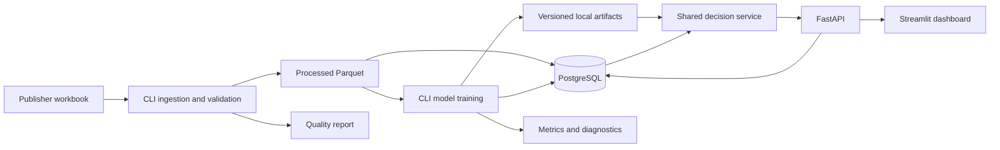

# Architecture and API



## Responsibilities

The CLI owns all loading and fitting. Notebooks reuse its Python modules. The dashboard is an HTTP client and never implements its own pricing mathematics. FastAPI validates requests and calls the decision service. PostgreSQL stores observations, lookups, dataset metadata, model-run summaries and scenario snapshots. Fitted coefficients, covariance, preprocessing and XGBoost remain local versioned artifacts.

Model runs are immutable timestamped directories. `artifacts/latest.txt` points at the active run only after database registration succeeds. The API loads it once per process; restart after training. Dataset identity must match model metadata. Loading source data is transactional, so readers do not see half an import. For this local version, stop services during a data replacement rather than attempting a live rollout.

Saved scenarios contain the validated request, resolved defaults, model version, dataset ID, fixed historical forecast week, assumptions and complete output. Retrieving a scenario returns the saved result rather than silently recomputing it with a newer model. Artifacts retain the corresponding coefficients for independent reproduction.

## Endpoints

| Method and path | Behavior |
|---|---|
| `GET /health` | Database/model readiness and active version; 503 if unavailable |
| `GET /products` | Modeled catalog, evidence eligibility, dataset quality, next historical week |
| `GET /products/{id}/analysis?store_id=...` | Weekly history, diagnostics, metrics, store list and optional scenario context |
| `GET /models/metrics` | Model version, temporal evaluation and per-product metrics |
| `POST /scenarios` | Validate, simulate and persist a baseline/proposal comparison |
| `GET /scenarios/{id}` | Retrieve the original saved comparison |
| `POST /recommendations` | Evaluate constrained candidates; does not persist an automatic decision |

Unknown products/stores return 404. Invalid values, conflicting price inputs, and unsupported scenario settings return 422. Unavailable data/models/database return 503. API docs expose typed input constraints. Both simulation responses contain the model version, baseline, assumptions and warnings. Recommendation status is `recommended`, `insufficient_evidence`, or `infeasible`.

### Scenario example

```json
{
  "product_id": "1111035398",
  "store_id": "24991",
  "reference_price": 2.99,
  "discount_pct": 10,
  "support": {"feature": 0, "display": 0, "tpr_only": 0},
  "unit_cost": 1.20,
  "promotion_cost": 0,
  "baseline_promotion_cost": 0
}
```

This is a contract example, not a promise that the illustrative price passes the current product/store support range. Obtain `/analysis` context before submitting. Supply either `price` or `discount_pct`, never both. Omit both to use the baseline. Omit support to retain baseline support. The forecast date is server-owned and cannot be overridden.

### Recommendation inputs

Required: `product_id`, `store_id`. Optional: `max_discount_pct` (20 by default), `unit_cost`, `promotion_cost`, `baseline_promotion_cost`, and `min_margin_pct`. A minimum margin requires unit cost. There is no multi-product budget allocation, so direct enumeration is clearer than an integer-programming dependency.

## Runtime

Docker Compose includes PostgreSQL, a one-shot setup pipeline, API and dashboard. The dashboard waits for API health. Local services bind to localhost. No authentication or public serving is included. Raw source files and large runtime artifacts are excluded from version control; quality/metrics reports are reviewable text.
